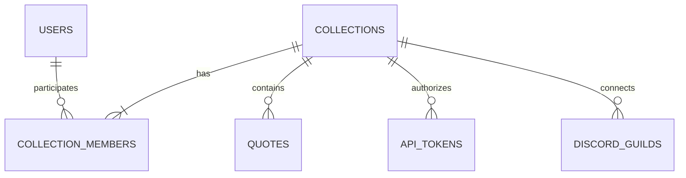

# Quote collections

Quotes belong to collections. QuoteDB users are people who can manage those collections;
a Discord server no longer needs an account pretending to be the server.

## Relationships



Every user has one personal collection. Shared collections can have multiple members,
with one owner. A guild connects to one shared collection; the bot accepts only guilds listed in `DISCORD_GUILD_IDS`. Different guilds could deliberately
connect to the same collection, but membership in Discord does not automatically grant
website access. Discord members do not need QuoteDB accounts to use bot commands.

`quotes.collection_id` is the access boundary. `created_by_user_id` records the signed-in
submitter when there is one; the existing SQL `user_id` column now stores this optional
attribution, never ownership. Author text remains independent, so quoting someone does
not require creating an account for them. Bot writes record source `discord`, guild ID,
submitter ID, and original message/author IDs when captured from a message. The quote’s
date is still the original message date, and author text is a display-name snapshot.

## Roles and tokens

| Role | Permissions |
|---|---|
| Viewer | Read, list, search, random |
| Member | Viewer plus create, edit, delete any quote in the collection |
| Administrator | Member plus rename, manage viewers/members and integration tokens |
| Owner | Administrator plus grant/remove administrators and transfer ownership |

Only the owner can convert a personal collection to shared. Conversion keeps its ID,
quotes, and tokens in place and creates a new empty personal collection. Personal
collections cannot accept other members or issue integration tokens. A shared owner
must transfer ownership before their account can be deleted by a site administrator.
Site administrators retain their existing global administrative access.

There are two credential types:

- Personal tokens are created in **Settings → API tokens**, bound to the current
  personal collection. Existing tokens stay bound to their original collection after
  conversion. They require an active account and current collection membership/role.
- Integration tokens are created in **Manage collections** for shared collections.
  They support `quotes:read` and `quotes:write`, never account/profile administration.
  They belong to the collection, not their issuer, and remain valid after that person
  leaves or is deleted. Collection administrators can revoke them. Expiry is supported
  through the API; the website currently creates non-expiring tokens.

Tokens cannot select another collection or manage memberships/tokens. A token with
write scope may edit/delete quotes through the API even though the initial Discord
commands only offer creation. Keep bot tokens private and grant only needed scopes.

## Website and API

The website’s collection picker controls the quotes and random pages and persists the
selection per signed-in user. **Manage collections** creates or converts collections,
manages existing accounts by email, transfers ownership, and issues/revokes integration
tokens. Site administrators can also open **Admin → Collections → collection name**
to rename, convert, add/update/remove members, and transfer ownership for any collection,
without joining it. These operations use session-only `/api/v1/admin/collections/:id`
routes with the same member/transfer suffixes and retain the one-owner rule.
The site admin quote table/editor uses collections instead of user owners.

Session-authenticated quote lists/random requests accept `collection_id` in the query;
creation accepts it in the body. Omitting it selects the user’s personal collection.
Individual quote operations check membership in the quote’s actual collection. Tokens
default to their bound collection and cannot override it with another collection ID.
The v1 user-path compatibility routes remain personal-only; old tokens pinned to a
converted collection should use `/api/v1/quotes` instead of the legacy user path.

Collection management endpoints (session only):

- `GET/POST /api/v1/collections`
- `PATCH /api/v1/collections/:id` — rename or convert with `kind: "shared"`
- `GET/PUT /api/v1/collections/:id/members` — PUT accepts `email` and `role`
- `DELETE /api/v1/collections/:id/members/:userId`
- `POST /api/v1/collections/:id/transfer` — accepts `user_id`
- `GET/POST /api/v1/collections/:id/tokens`
- `DELETE /api/v1/collections/:id/tokens/:tokenId`

`GET /api/v1/token-info` reports token `kind` and collection identity. Personal tokens
also include the legacy owner identity. `/quote setup` accepts only collection tokens
with both read/write scopes and privately confirms the collection before connecting.

`IZARO_COLLECTION_ID` explicitly selects the collection published by `/public/izaro`
and the bot’s `/izaro` command. It takes precedence over the legacy `IZARO_USER_ID`,
which resolves to that account’s current personal collection. Set the explicit ID
before converting an Izaro personal collection if its existing quotes should stay public.
All other collections remain private; there is no public collection browser.

## Migration and deployment

Stop the bot and application writers and take a PostgreSQL backup before upgrading.
Run the API migration before the bot migration, then start the updated applications.
Do not run an old API binary against the migrated schema.

```bash
pnpm db:migrate
pnpm --filter @quotedb/discord-bot db:migrate
pnpm --filter @quotedb/discord-bot register
pnpm dev
# Separate terminal:
pnpm dev:discord
```

The API migration backfills one personal collection per existing user and assigns every
quote and personal token to it. IDs, quote content, timestamps, soft-delete status, and
existing token secrets remain unchanged. A database trigger creates personal collections
for new users, including seed/import/admin flows. The v1 importer writes collection IDs.

The bot migration uses privileged database credentials and the existing encryption key
to upgrade saved legacy connections in the same PostgreSQL database:

1. Validate the saved credential and required scopes.
2. Convert its personal collection to shared; create a new empty personal collection
   for the original account. Quotes stay in the same collection.
3. Mint a dedicated collection token and atomically replace the encrypted bot credential.
   The old personal token remains unchanged for any existing scripts.
4. Save collection identity and invalidate old pagination/configuration revisions.

The upgrade is transactional and repeatable. Missing encryption keys, expired/revoked
credentials, or invalid ciphertext stop the upgrade rather than discard a connection.
Reconnect or repair the credential before retrying. Backups must include the bot schema
and encryption key (stored separately). Restoring an old binary also requires restoring
the pre-migration database; do not remove new columns in place.

Runtime bot credentials remain restricted to `discord_bot`; only the one-shot migration
process can access core tables. Deploy/self-host overrides order the bot migration after
API migrations. An API hosted on a separate database requires explicitly configuring the
new collection token through `/quote setup` instead of automatic credential upgrade.

## Verification

Automated tests cover collection isolation, membership roles/removal, concurrent owner
transfers, token scope restrictions and issuer independence, conversion without moving
quotes, and legacy personal token binding. A populated legacy PostgreSQL migration test
checks quote/date/secret preservation, encryption failure rollback, and repeatability.
Browser tests cover collection creation, selection persistence, quote isolation, and
issuing/using an integration token, alongside existing web and admin workflows.
