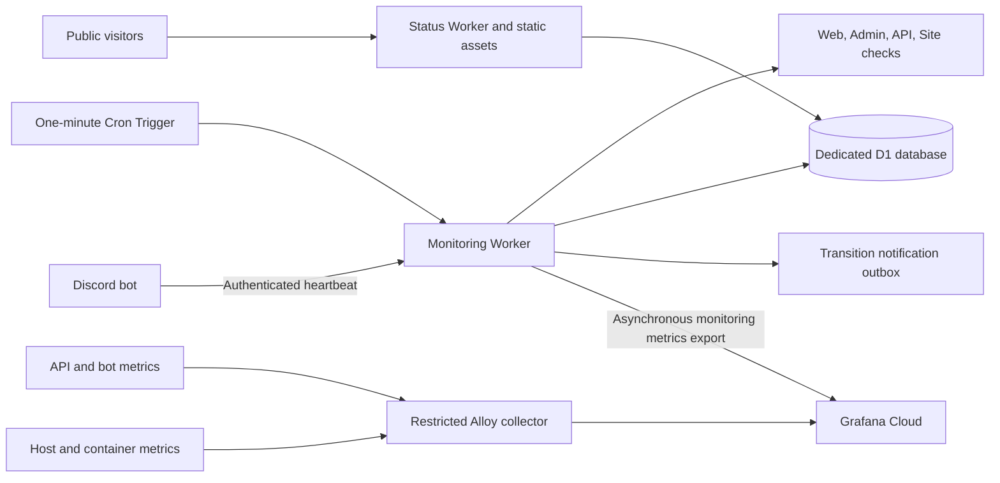

# Status page and performance monitoring implementation plan

Status: implemented and deployed; one-week load review remains.
Implementation details and measured limits: `infra/observability/README.md`.
Date: 2026-11-02.

## 1. Agreed scope

Implement solution 1: a custom Cloudflare Workers + D1 status page, with Grafana
Cloud for private performance monitoring.

Plan decision: use Cloudflare Workers Free and D1's free allowances, with Grafana
Cloud Free. Keep one-minute monitoring, 30-second bot heartbeats, and 30-second
public-page polling. No paid Workers subscription is planned.

- Public URL: `https://status.quotes.elmu.dev`.
- Exactly five public components: Web, Admin, Discord bot, API, Site.
- Display current status and historical uptime for each component.
- Display an ongoing incident at the top whenever a component is unavailable or
  experiencing sustained elevated latency. List affected components individually:
  red for unavailable, yellow for elevated latency.
- Provide a private Grafana dashboard for application and infrastructure performance.

Thresholds, retention, implementation paths, and rollout order below are proposed
working defaults. They can be tuned without changing the agreed product scope.

## 2. Existing repository and constraints

- `infra/README.md` describes one DigitalOcean Droplet running Caddy, API,
  PostgreSQL, and optionally the bot. The default machine has 1 GB RAM.
- `apps/api/src/server.ts` already exposes `/healthz`, including a PostgreSQL
  `select 1`. Reuse it; do not introduce a redundant readiness endpoint.
- `apps/discord-bot/src/index.ts` already checks the database, API, and
  `client.isReady()` through a loopback health server on port 8090.
- Web is `app.quotes.elmu.dev`; Site is `quotes.elmu.dev`; API is
  `api.quotes.elmu.dev`.
- Per `docs/AUTH.md`, the canonical Admin host defaults to
  `admin-quotes.elmu.dev`; `admin.quotes.elmu.dev` redirects there. Resolve the
  deployed `ADMIN_HOST` rather than monitoring the old redirect as the application.
- Admin static pages and APIs require an Access JWT and an active local human
  administrator. An Access service token alone will not satisfy the existing guard.
- Existing PostgreSQL backups do not cover the proposed D1 database.

These are repository observations, not a verification of live deployment state.
Keep monitoring storage and serving independent of the application Droplet.

## 3. Architecture

Use separate monitoring and public-serving Worker entrypoints under one new
`apps/status` workspace package. The public Worker serves static assets and a
sanitized JSON API; only the monitoring Worker receives heartbeat credentials,
probe credentials, and notification/export secrets. Neither needs application DB
credentials. The monitoring Worker can use the public hostname's authenticated
ingestion route through a service binding if that simplifies routing.

D1 is the authority for results and incidents. Grafana ingestion failures must
never prevent checks, incident updates, or public-page reads. Do not add Durable
Objects, Queues, or KV until measured requirements justify them.

Design for the Free plan's 10 ms CPU budget per HTTP or cron execution. Network
and database waiting do not consume CPU time, but parsing, state evaluation and
serialization do. Serve static assets directly without invoking the Worker first.
Precompute compact public summaries instead of scanning raw history on page reads.
Process retention/rollup/export work in bounded batches, independently from the
critical check/state update path when profiling shows it is necessary. Any extra
scheduled work must fit the account's remaining cron and request allowances.

## 4. Availability checks

| Component | Initial check | Meaning and limitations |
| --- | --- | --- |
| Web | Fetch login/app shell, validate a stable content marker and referenced built asset; combine with API readiness | Covers serving the app and its essential API dependency; does not prove email-code delivery or every browser interaction |
| Admin | Probe a narrowly scoped, authenticated monitoring route on canonical `ADMIN_HOST`; validate deployed admin asset and API/DB readiness | Covers admin serving and dependencies, but not human OTP sign-in |
| Discord bot | Bot sends readiness heartbeat every 30 seconds with Discord readiness, DB/API health and gateway latency | Covers connection and dependencies; command success/duration are additional Grafana signals |
| API | Existing `/healthz` plus a deterministic read-only public API request with response validation | Detects database failure and representative application failure |
| Site | Fetch homepage and validate expected content plus a referenced built asset | Detects static serving failures and incomplete frontend deployments |

Identify the representative API route from current routes during implementation.
Use a controlled public fixture or validate the response schema without requiring
real user content. Never create quotes or send login emails as routine probes.

### Admin monitoring authentication

Implement a dedicated health-only path with its own Access service-auth policy
and origin-side credential/JWT verification. Keep it outside existing human admin
routes and role middleware. It must return only health results and must not grant
access to admin HTML, user information, or administrative operations.

Use an internal Caddy path/asset check to validate the admin build through this
route. Test that anonymous requests and arbitrary service identities are denied.
Document explicitly that this is not an end-to-end human login check. Add a
separate browser sign-in smoke test later only if its value warrants maintaining
a test account and OTP workflow. Never relax `/api/v1/admin/*` authorization to
accommodate monitoring.

### Probe execution and bot heartbeat

- Run HTTP checks every minute with bounded concurrency, five-second request
  timeouts, bounded response bodies, and explicit expected status/content.
- Use fixed configured targets; never accept user-supplied probe URLs. Reject
  unexpected redirects, especially redirects to Access/login/error pages.
- Avoid cached health responses. Keep checks on public URLs so they exercise DNS,
  TLS, and the serving path.
- Record check execution time, duration, result, and a sanitized failure category.
- Refactor bot readiness into a shared helper for its existing health server and
  outbound heartbeat. Sending failures must not crash or block the bot.
- Heartbeats include a unique ID, monotonic sequence within a boot ID, readiness,
  dependency states, and gateway latency. Use server receipt time for freshness;
  validate payload size/types and reject replays or out-of-order updates.
- Authenticate ingestion with a rotatable per-bot secret; never send Discord
  tokens, collection credentials, guild IDs, message text, or quote content.

## 5. State and incident rules

Keep individual probe results, computed component state, and incident lifecycle
separate. Components may be `operational`, `degraded`, `down`, `unknown`, or
`maintenance`. Use text/icons in addition to color.

Initial rules:

- Down: two consecutive failed one-minute evaluations.
- Degraded: three of the last five valid successful evaluations exceed a
  configurable threshold. Start HTTP thresholds at 1,500 ms; tune per component
  after collecting a baseline. Invalid/missing gateway latency is not zero.
- Bot: evaluate fresh readiness reports each minute. A heartbeat older than
  180 seconds means unavailable when the monitoring scheduler is healthy.
- Bot latency: initially use a separate configurable 500 ms gateway threshold;
  do not equate gateway latency with command execution latency.
- Recovery: three consecutive fully healthy evaluations; sustained successful
  but slow responses may transition from down to degraded rather than staying red.
- Unknown: no monitoring evaluation for more than 180 seconds, or insufficient
  data after initial setup. Never display stale green as current operational status.
- Down takes precedence over degraded. Freshness/unknown handling takes
  precedence over presenting stale measured states as current facts.

Persist per-component incident episodes. The page aggregates active episodes
into one top banner, listing every affected component and its current severity.
Use neutral wording such as “Service disruption”; simultaneous failures do not
prove a common root cause. Preserve first failure time and confirmation time.
Retries must not duplicate incidents or recovery notifications.

Where API failure makes Web/Admin/Bot unusable, mark the dependent component
affected and retain the dependency reason. Do not claim an independently measured
frontend outage. Group notifications so one Droplet failure does not generate a
separate noisy alert for every check.

Missing telemetry cannot resolve an incident. A stale-monitoring banner replaces
claims about current availability while prior unresolved incidents remain visible.
Support explicit scheduled maintenance and optional operator notes through an
authenticated CLI/API in the first version; a management UI is not required.

## 6. Storage, uptime, and retention

Proposed D1 tables:

- `check_results`: target, scheduled bucket, observation time, duration, outcome,
  failure category; unique target/bucket identity for idempotency.
- `component_state`: current state, evaluation time, consecutive counters and
  last-success time, updated atomically with incident transitions.
- `bot_heartbeats`: latest receipt, boot/sequence identity and bounded health data.
- `incidents` / `incident_events`: component episodes, transitions, notes and
  resolved timestamps.
- `maintenance_windows`: explicitly scheduled component maintenance.
- `daily_rollups`: observed available, unavailable, degraded, unknown and
  maintenance durations per component and UTC day.
- `notification_outbox`: transition/export delivery status, attempts and next retry.

Use transactional batches and unique constraints to protect against duplicate or
overlapping scheduled invocations. State updates must reject older evaluations.
Rollups and pruning must be repeatable without double-counting.

Retain detailed checks for 14 days, daily aggregates for at least 400 days, and
incident history for at least one year. Show 24-hour, 30-day and 90-day availability.
Expose measurement start date and coverage; do not invent pre-monitoring history.

Calculate time-based availability from observed intervals. Successful slow
intervals count as available and separately as degraded. Exclude unknown and
scheduled maintenance from the denominator, displaying both exclusions and
coverage explicitly. Cap how long a result represents an interval before it
becomes unknown. Label all-unknown windows “No data,” not 100%.

Calculate measurement history from raw observations, not only debounced incident
states. This preserves short failures while reducing public incident flapping.
Describe the sampling method and exclusions on the page; this is observed
availability, not a contractual SLA calculation.

## 7. Public interface

- Match the application's existing visual language using a lightweight static UI.
- Show overall state, active incident banner, five component rows, uptime history,
  recent resolved incidents, last check, and scheduled maintenance.
- Red banner if any component is down; yellow when affected components are only
  degraded. Each affected component retains its own severity color.
- Provide accessible daily-history tooltips and a mobile layout.
- Poll a compact `/api/status` response every 30 seconds; use a short bounded
  cache lifetime and explicit observation timestamps. Show stale state on fetch
  failure rather than retaining an apparently live green display.
- Publish only aggregate health information. Keep raw errors, credentials,
  infrastructure addresses and detailed operational metrics private.
- Serve the static page shell even if D1 is unavailable; show monitoring unavailable.

## 8. Grafana implementation

Use Grafana Cloud initially. Run a tightly scoped Alloy collector on the Droplet
with a measured memory/CPU budget; avoid a local metrics database or Grafana server.
Measure resource headroom before enabling container collection. Increase Droplet
capacity if the collector materially competes with application workloads.

Instrument API and bot using bounded-label Prometheus metrics scraped privately
by Alloy. Add traces through OpenTelemetry later where diagnosis warrants them.
Because the bot's current health server is loopback-only, expose metrics on a
separate Docker-network-only listener or another explicitly private transport;
do not publish a host port. Restrict exporter access similarly for the API.

| Dashboard section | Initial panels |
| --- | --- |
| Service overview | Five computed states, heartbeat freshness, external probe latency and failure counts |
| API | Request volume, p50/p95/p99 duration, 5xx rate, normalized route breakdown |
| Bot | Readiness, gateway latency, command count/duration/errors, reconnects |
| Host/containers | CPU, memory, swap, disk usage, container memory and restarts |
| PostgreSQL | Connections, query duration where instrumented, locks, database size |
| Frontends, later | Faro Core Web Vitals and JavaScript errors for Web/Admin/Site |

Export public monitoring measurements asynchronously from the monitoring Worker
using Grafana's supported OTLP HTTP ingestion. Keep a bounded retry mechanism and
make export failure observable. Grafana and the status page must share the same
component identifiers and computed state semantics.

Store dashboard JSON and collector configuration in `infra/observability/`.
Provision dashboards reproducibly and keep Grafana private. Do not use quote IDs,
user/guild IDs, raw URLs, request IDs, or arbitrary error messages as metric labels.
Redact tokens, cookies, emails and content from exported logs/traces. Bound log
volume and retention; enable browser telemetry only after reviewing data capture.

Use the status incident engine for availability notifications and Grafana alerts
for resource/performance diagnosis. Avoid duplicate availability notifications.
Notification delivery is an optional configurable integration; deployment should
not depend on Discord being available to report a Discord outage.

## 9. Repository changes and deployment

Expected additions/changes:

- `apps/status/`: package, Worker entrypoints, UI, state reducer, D1 migrations,
  tests and Wrangler configuration.
- `apps/api/`: metrics instrumentation and scoped admin-monitoring verification.
- `apps/discord-bot/`: shared readiness helper, heartbeat sender and metrics.
- `infra/observability/`: Alloy configuration, Grafana dashboard JSON and runbook.
- `infra/droplet/` and `infra/selfhost/`: collector configuration and secret wiring.
- `infra/terraform/`: explicitly owned monitoring resources and Access policy.
- `.github/workflows/status-deploy.yml`: independent status build/deploy pipeline.
- Existing CI/workspace configuration: include status typechecking, build and tests.
- `docs/AUTH.md` and `infra/README.md`: document the monitoring exception, topology,
  operation, provisioning, backup and rollback procedures.

Choose one owner per resource: use Wrangler for Worker versions, bindings and
cron configuration; use OpenTofu for supported account/domain/Access resources
and D1 provisioning after verifying current provider schemas. Do not let both
tools independently manage the same domain/DNS resource.

Configure `status.quotes.elmu.dev` as a Worker Custom Domain and verify certificate
coverage for that exact nested hostname before launch. Do not assume the ordinary
`*.elmu.dev` zone certificate covers it or route it to the Droplet.

Keep CI deployment credentials, heartbeat secret, Access service credentials,
Grafana ingestion credentials and optional alert credentials in secret stores.
Do not emit secrets in plans, generated files committed to Git, browser bundles,
public JSON, or logs. Follow the repository's existing encrypted state handling.

Use additive D1 migrations before deploying compatible Worker versions. Keep
previous Worker versions available for rollback; rolling back code must not drop
measurement history. Document D1 recovery/export and rehearse a restore to a
separate database. Deploying the application must not redeploy or reset status.

## 10. Delivery phases and acceptance checks

### Phase 1 — Foundations and contracts

- [x] Confirm live hostnames, deployed bot enablement, Cloudflare account/zone and
  Grafana stack region; choose the controlled API check target.
- [x] Specify status/heartbeat schemas, timestamp semantics and state transitions.
- [x] Scaffold workspace, local Worker development, D1 migrations and fixtures.
- [x] Confirm remaining account-wide free allowances and record a request,
  database operation and storage budget for the implementation.
- [x] Implement health-only admin monitoring without broadening admin privileges.

### Phase 2 — Monitoring and public page

- [x] Implement scheduled checks, bot heartbeat, reducer, rollups and incidents.
- [x] Implement public UI/API, maintenance and operator-note commands.
- [x] Test timeout/content failures, latency windows, recovery hysteresis,
  duplicate/late invocations, midnight boundaries and monitoring gaps.
- [x] Test heartbeat authentication, stale/malformed/replayed reports and shutdown.
- [x] Test admin isolation and public response redaction.
- [x] Browser-test all-green, mixed red/yellow, all-down, maintenance, no history,
  stale scheduler and D1 failure using fixtures.

### Phase 3 — Grafana and operational readiness

- [x] Add API/bot metrics, collector config, monitoring export and dashboards.
- [x] Verify histogram quantiles and bounded route labels with known test traffic.
- [x] Verify memory/CPU overhead and that telemetry outages cannot block requests.
- [x] Profile deployed Free-plan Worker CPU for normal checks, all-target timeout,
  incident transitions, heartbeat verification, page reads and export/cleanup.
  Keep measured CPU comfortably below 10 ms per invocation; reduce or split work
  if necessary. Running checks less often does not increase this per-run budget.
- [x] Verify D1 rows read/written, index/delete overhead and projected database
  size with representative history. Test quota-error handling and ensure missing
  monitoring data is shown as unknown rather than operational.
- [x] Implement optional transition notifications and test retry/deduplication.
  Delivery is opt-in; infrastructure/freshness email alerts are enabled.
- [x] Add an independent external monitor for the status endpoint and scheduler
  freshness. Alert outside the monitored Cloudflare path.
- [x] Document retention, estimated costs, credentials, restore and rollback.

### Phase 4 — Release

- [x] Deploy a preview with nonproduction targets; inject failures there rather
  than deliberately disrupting production services.
- [x] Run relevant repository checks: status tests/build/typecheck, API/bot tests
  for changed behavior, root lint/typecheck, and OpenTofu/shell checks if changed.
- [x] Provision production resources and deploy status independently.
- [x] Enable production probes/heartbeats, verify TLS and freshness, and start
  history at the real first observation time.
- [x] Confirm a simulated incident displays the correct affected services and
  resolves only after recovery confirmation.
- [ ] Review thresholds and resource/telemetry usage after a week of normal load.

Done means the requested URL serves all five components with truthful freshness,
uptime history and automatic red/yellow incident presentation; Grafana receives
useful private performance measurements; and failures of the Droplet, scheduler,
storage or telemetry export have tested, documented behavior.

## 11. Cost assumptions and references

Target $0/month incremental Cloudflare Workers/D1 and Grafana subscription cost,
within their free allowances. Existing Droplet/domain costs remain. Any optional
notification or external-monitoring service must be assessed separately; do not
introduce a paid dependency or upgrade automatically. Grafana Cloud Free's 14-day
telemetry retention does not replace D1's long-term public uptime history.

Relevant Free-plan limits checked on 2026-11-02:

| Resource | Free allowance/limit |
| --- | --- |
| Dynamic Worker requests | 100,000/day per account |
| CPU | 10 ms per HTTP or cron invocation; network/database waiting excluded |
| Memory | 128 MB per isolate |
| Outgoing subrequests | 50 per invocation; at most six simultaneous outgoing connections |
| Cron triggers | Five per account |
| D1 reads/writes | Five million rows read/day; 100,000 rows written/day |
| D1 database size | 500 MB per database; 5 GB total storage per account |
| D1 queries | 50 per Worker invocation |
| D1 point-in-time recovery | Seven days |
| Direct static asset serving | Free, unlimited requests |

Allowances are shared with other account usage. Free daily request/database limits
are hard limits: exhaustion causes errors until reset at midnight UTC, rather than
automatic paid overages. Storage exhaustion requires cleanup. Build quota/error
visibility into operations and preserve a static page shell with an unavailable
or stale state when dynamic requests fail. Alert before approaching allowances.

At the retained frequencies, baseline monitoring is 1,440 cron runs plus 2,880 bot
heartbeat requests per day: approximately 4,320 executions before public traffic,
retries, exports and extra Worker invocations. Each continuously open page adds
2,880 status API requests/day at 30-second polling. Pause polling in hidden tabs
and use bounded caching to reduce D1 reads; Worker-level caching alone does not
remove dynamic Worker invocation counts.

Five one-minute component evaluations produce 7,200 evaluations/day. Actual HTTP
requests and rows written will be higher because of asset checks, dependencies,
heartbeats, indexes and incident state. Account for public API reads and cleanup
writes as well; do not size from scheduler invocation count alone.

Validate the proposed 14-day raw/400-day aggregate retention against the 500 MB
database limit including indexes. Keep payloads small and prune incrementally.
Do not claim Free-plan feasibility until deployed CPU and D1 usage are measured.
If the design cannot fit after optimization, document the constraint and propose
an explicit scope or plan change before adding paid services.

Official references checked during planning:

- [Workers Cron Triggers](https://developers.cloudflare.com/workers/configuration/cron-triggers/)
- [Workers pricing](https://developers.cloudflare.com/workers/platform/pricing/)
- [Workers limits](https://developers.cloudflare.com/workers/platform/limits/)
- [Static asset billing](https://developers.cloudflare.com/workers/static-assets/billing-and-limitations/)
- [D1 pricing](https://developers.cloudflare.com/d1/platform/pricing/)
- [D1 limits](https://developers.cloudflare.com/d1/platform/limits/)
- [KV consistency](https://developers.cloudflare.com/kv/concepts/how-kv-works/)
- [Access service tokens](https://developers.cloudflare.com/cloudflare-one/access-controls/service-credentials/service-tokens/)
- [Grafana pricing](https://grafana.com/pricing/)
- [Grafana OTLP ingestion](https://grafana.com/docs/grafana-cloud/send-data/otlp/send-data-otlp/)
- [Alloy Docker monitoring](https://grafana.com/docs/alloy/latest/monitor/monitor-docker-containers/)
- [Grafana Frontend Observability](https://grafana.com/docs/grafana-cloud/observe-and-act/monitor-applications/frontend-observability/)

Cron Workers do not provide controlled multi-region probe placement merely by
running on Cloudflare. This first release measures availability from its probe
vantage point. Managed multi-region/browser checks are a later enhancement.

Implementation note: transition webhooks are implemented and retry/deduplication-tested,
but optional public incident notifications are disabled. Infrastructure/status freshness
alerts use Grafana email and dashboard. CPU profiling required separate probe-pair,
evaluation, summary and export crons; all five free cron slots are used.
